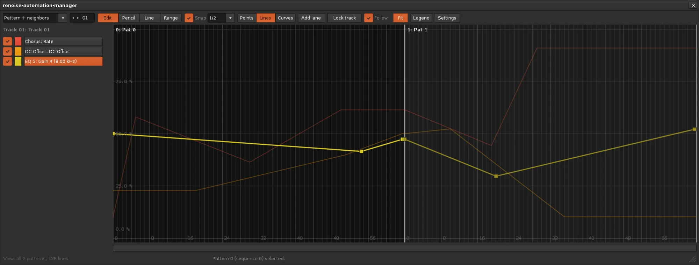

# renoise-automation-manager

A Renoise tool that shows every graphical automation envelope of a track overlaid in one floating window, each curve in its own color (similar to the automation view of other DAWs), and lets you edit them directly: points, pencil, line, rectangle selection, copy and paste. Changes are written to the song immediately and stay in sync with the native Automation editor.



*Three automations of one track (Panning, Volume, Width) overlaid in Pattern + neighbors mode; the active curve is drawn on top with its points, the others are dimmed.*

## Requirements

- Renoise 3.5 or newer (scripting API 6.2).
- Windows, macOS or Linux. Developed and checked on Windows 11.

## Download

Each GitHub release has two files in its **Assets** section:

- `com.glitch191.RenoiseAutomationManager-<tag>.xrnx`: the tool.
- `com.glitch191.RenoiseAutomationManager-<tag>.xrnx.sha256`: its SHA-256 checksum.

To verify the download in PowerShell, compare the output with the content of the `.sha256` file:

```powershell
Get-FileHash -Algorithm SHA256 .\com.glitch191.RenoiseAutomationManager-v1.0.0.xrnx
```

## Installation

Drag and drop the `.xrnx` file onto the Renoise window, or double-click it. Renoise installs it in its tools folder.

## Opening the tool

- `Tools > Multi Automation View...` in the main menu.
- `Multi Automation View...` in the right-click menu of the Track Automation editor or of the Pattern Editor.
- A keyboard shortcut: assign `Global > Tools > Toggle Multi Automation View` in `Edit > Preferences > Keys` (Renoise does not allow tools to set default shortcuts).

## Using it

The window has a toolbar, a legend on the left and the curve canvas.

**Legend.** One row per automated parameter, shown as `Device: Parameter`. The checkbox hides or shows the curve; a click on the color swatch or name makes the curve active. Hidden curves, colors and the track lock are stored in the song.

**Active curve.** Only one curve is editable at a time. It is drawn on top, thicker and opaque, with its points. Other curves are dimmed (opacity set in Settings, 35 % by default). Click near a curve (Edit tool) to make it active without changing any point. Selecting a parameter in the native Automation editor activates its curve, and the other way round.

**Time modes** (first toolbar menu):

- *Current pattern*: the selected pattern, or the playing one when *Follow* is on and Renoise is playing.
- *Pattern range*: several sequence positions side by side (From, To, *Song* for the whole song), with pattern separators and numbers. A pattern used more than once in the range is hatched and labelled *alias*; editing it changes every occurrence, and the status line says so. Pattern track aliases are resolved to their source pattern.
- *Pattern + neighbors*: the current pattern is editable in the center, with 1 to 4 read-only neighbor patterns on each side. Click in a gray neighbor pattern to select it in Renoise: it becomes the editable center (while Renoise plays with *Follow* on, the view stays on the playing pattern).

**Tools:**

| Tool | Action |
| --- | --- |
| Edit (E) | Double-click: add a point, or delete the point under the mouse (like the native editor). Drag a point: move it (in Pattern range mode, also into the next or previous pattern). Drag on empty space: rectangle selection. |
| Pencil (P) | Freehand drawing; points are created at the snap grid and replace the drawn range. |
| Line (L) | Straight ramp between press and release (or two clicks); replaces the range, can cross patterns in Pattern range mode. |
| Range (R) | Drag: select a time range over every visible curve. Del, Ctrl + C, Ctrl + X, Ctrl + V, Left, Right or the right-click menu then delete, copy, cut, paste or shift that passage in all those curves at once, in one undo step. Hidden curves are left alone. |

**Mouse and keys:**

| Input | Action |
| --- | --- |
| Shift while dragging | Fine move (one tenth), without snap or magnet |
| Ctrl while dragging | Constrain to one axis |
| Double-click or Alt + click on a point | Delete it |
| Right-click | Context menu (see below); a right-click on a point selects it, it never deletes |
| Alt + wheel (Alt + Shift + wheel) | Scale selected values around center (from bottom) |
| Left, Right | Shift the selection by one grid step (Shift: 1/256 line) |
| Del | Delete the selection |
| Ctrl + C, Ctrl + X, Ctrl + V | Copy, cut, paste at the mouse position (works on another curve or pattern; with the Range tool, on every visible curve) |
| Ctrl + P, Ctrl + I | Paste continuously, insert paste |
| Ctrl + K | Cut the selected time |
| Ctrl + F, Ctrl + Shift + F, Ctrl + R | Flip, mirror, humanize the selection |
| Tab, Shift + Tab | Next, previous curve |
| Wheel | Scroll in time |
| Ctrl + wheel | Zoom in time around the mouse |
| Ctrl + plus, Ctrl + minus, Ctrl + 0 | Interface zoom up, down, back to 125 % |
| Esc | Cancel the gesture, the range or the selection; close the window |

**Context menu** (right-click), modelled on the native Automation editor menu:

- *Cut*, *Copy*, *Paste*: the selected points, or with the Range tool the range of every visible curve.
- *Paste Continuously*: repeats the clipboard from the mouse position to the end of that pattern.
- *Insert Paste*: pastes at the mouse position and pushes the later points of that pattern to the right.
- *Cut Selected Time*: copies the selected time (range, or span of the selected points), removes it and pulls the later points to the left.
- *Delete Envelope*: deletes the automation of the active curve in the editable patterns.
- *Process*: flip, mirror, humanize the selection; create random points, an exponential, linear or sine curve over the selected time (or the pattern under the mouse when nothing is selected), at the snap grid; scale the selected values.
- *Lock Zoom* (keep the time zoom when the shown patterns change), *Zoom Out Fully*, *Zoom To Current* (the current pattern, or the one under the mouse in Pattern range mode).
- The tools, and the interpolation of the active curve.

The generated curves go from bottom to top; use Flip and Mirror to turn them around. Renoise does not document the exact behaviour of its own menu commands, so these follow their names and may differ in details.

**Magnet.** Near a pattern start or end (a few pixels), a point you add, move or draw with the Line tool sticks exactly onto the border (the end is the last 1/256 of the last line), and its value sticks to the value of the neighboring pattern at that border, so two patterns can be joined precisely. Hold Shift to turn it off.

**Link patterns** (right-click menu or Settings, off by default). Renoise plays each pattern's automation on its own: the value holds after the last point of a pattern and before the first point of the next. With *Link patterns* on, the tool keeps two border points on the straight line between the last point before each pattern border and the first point after it, so adjacent patterns read as one continuous line. They are added when the option is turned on and kept up to date after every edit, in the same undo step. Only editable patterns are written (in Pattern + neighbors mode, the center pattern only), and patterns used twice in a row are left alone.

Other toolbar controls: *Snap* and the grid (Line, 1/2, 1/4, 1/8, Free), the interpolation of the active curve (Points, Lines, Curves), *Add lane* (menu of automatable parameters without automation), *Lock track* (keep showing this track), *Follow* (follow playback), *Fit* (show the whole range), *Legend*, *Settings*.

**Zoom indicator.** The bottom left of the window always says how much of the time range is shown: `View: all 64 lines` when everything is visible, or for example `Zoom x16: Pat 2, lines 12 to 15 of 64` when zoomed in with Ctrl + wheel. The *Fit* button stays lit (theme selection color) as long as the whole range is shown, and turns back to a normal button as soon as you zoom in. While zoomed in, the pattern number is written on the canvas, even in Current pattern mode.

Every gesture (a drag, a pencil stroke, a line, a paste) is one undo step in Renoise, named for example `Multi Automation: Move points`. Drags and pencil strokes are written to the song while the mouse moves (about 20 times per second, as one batch undo step), so the native Automation editor follows live; *Write while dragging* in Settings turns this off.

**Ruler and value axis.** Line numbers (0-based) run along the bottom of the canvas, with a step that follows the zoom, down to quarter lines (`+64`, `+128`, `+192`, in 1/256 line). The left side shows the values of the active curve at the five horizontal guides.

**Values.** The value axis and hovering or dragging a point show the parameter, the time (pattern, line, sub-line, 0-based like the Pattern Editor) and the value. Real values are shown for linear parameters of native devices; other parameters are shown as a percentage. Reading values never changes a parameter.

**Window size.** Drag the grip in the bottom right corner of the window: the window follows the mouse and the status line shows its size. The size is kept as the Custom size in Settings.

**Settings** (button; every option explains itself in a tooltip): interface zoom (100 to 200 %), window size (Compact, Wide, Ultrawide, or a custom width and height), default tool, snap, inactive curve opacity, link patterns, write while dragging, follow playback, diagnostics. The diagnostics line shows the number of curves and points drawn, average and worst render time of the canvas (Lua drawing time measured with `os.clock`) and the playhead update rate. It can also be toggled with the `Global > Tools > Toggle Multi Automation View Diagnostics` key binding.

## Known limitations

- The window is a floating Renoise dialog: it cannot be docked in the lower frame, and Renoise does not let tools resize a dialog by its border. Use the grip in the bottom right corner instead. When the window gets taller than its legend allows, it is rebuilt on release to add legend rows, and may reopen at another position. The scripting API gives no screen size, so the window cannot follow the monitor width automatically.
- The interface zoom scales sizes, lines and hit areas, but not the fonts of Renoise controls.
- The Curves interpolation and the point scaling in Lines mode are drawn with an approximation (monotone cubic curve, power curve); Renoise does not document its exact formulas.
- Real values are approximate for some parameters (linear mapping only); plugin and non-linear parameters are shown as percentages.
- Patterns used several times in the sequence share their automation: editing one occurrence changes all of them.
- Hidden curves, colors and the active curve follow their track by name and device list. A track renamed and given other devices at the same time, while other tracks move, can lose its settings.
- Points move across patterns only inside a run of editable patterns (Pattern range mode); neighbor patterns stay read only.
- The playhead moves at the Renoise idle rate (about 10 times per second) and by whole lines.
- Live writes during a drag rely on the Renoise batch undo to group them; check in Renoise that Ctrl + Z undoes a whole drag. If not, turn off *Write while dragging*.

## Manual check list

1. Install the `.xrnx` (drag and drop), open the tool from the Tools menu, the Track Automation menu and the shortcut.
2. On a track with 8 automations: 8 distinct curves; hide one in the legend, it disappears; save, close and reopen the song: hidden state and colors are restored.
3. Click near an inactive curve: it becomes active, no point changes; Tab cycles curves; the native Automation editor follows.
4. Double-click adds a point, double-click on a point deletes it, drag moves it (with Shift and Ctrl), Alt + click deletes it, right-click opens the menu without deleting, snap grid works.
5. Pencil, Line (also across two patterns in Pattern range mode), rectangle selection, scale, shift, copy and paste to another curve and pattern, interpolation change, Add lane.
6. Ctrl + Z in Renoise undoes each gesture in one step.
7. Edit a point in the native editor: the tool updates in under half a second, and the reverse.
8. Change track, lock the track, delete a device, an automation, a track; load another song: no error in the scripting console.
9. Play the song: the playhead moves, Follow scrolls the view; Pattern range and neighbors modes match the native editor.
10. Ctrl + plus, Ctrl + minus, Ctrl + 0, the size presets on a 1920 x 1080 and a 3440 x 1440 screen.
11. Close and reopen the window on the same song: the whole range is shown. Open the window: Fit is lit. Zoom in with Ctrl + wheel: Fit turns normal and the zoom indicator shows the visible lines; click Fit: the whole range comes back and Fit stays lit.
12. Drag a point: the native Automation editor follows during the drag; Ctrl + Z undoes the whole drag; Esc during a drag restores the curve.
13. Move, insert and delete tracks: hidden curves and colors stay with their track.
14. Ruler and value axis readable at every zoom.
15. Pattern range mode: drag a point into the next pattern. Range tool: copy a passage of every curve, paste it in another pattern, shift it, delete it.
16. Drag the resize grip in the bottom right corner: the window follows the mouse in both directions, keeps the size after closing and reopening; release outside the window works too.
17. Every entry of the right-click menu, and its shortcut; Ctrl + Z undoes each in one step.
18. Magnet: drag a point to the end of a pattern, it sticks to the border and to the next pattern's value. Link patterns on: the curve is continuous across borders and stays so after edits.
19. Pattern + neighbors: a click in a gray pattern selects it in Renoise and makes it the editable center.

## Development

Requirements: LuaJIT or Lua 5.1 for the tests, PowerShell for the scripts.

```powershell
# Run the tests
powershell -ExecutionPolicy Bypass -File scripts/test.ps1

# Install for development (junction into %APPDATA%\Renoise\V<latest>\Scripts\Tools, auto reload on)
powershell -ExecutionPolicy Bypass -File scripts/install-dev.ps1

# Build dist/com.glitch191.RenoiseAutomationManager.xrnx
powershell -ExecutionPolicy Bypass -File scripts/build-xrnx.ps1

# Verification previews of the drawing logic (SVG in out/previews, not Renoise screenshots)
luajit tests/preview.lua
```

The development install creates a git-ignored `dev.flag` file that enables `_AUTO_RELOAD_DEBUG`; it is never included in the archive. For editor support, clone the official API definitions into `.cache/renoise-definitions` (`git clone https://github.com/renoise/definitions .cache/renoise-definitions`); `.luarc.json` points LuaLS to them.

Releases: publishing a GitHub release runs `.github/workflows/release.yml`, which runs the tests, converts the tag to the numeric manifest Version (`v1.2.0` becomes `1.0200`), builds the archive and attaches it with its checksum. The workflow can also be started by hand (Actions tab, *Release*, *Run workflow*); the archive is then kept as a workflow artifact.

All songs and data used in tests and previews are fictitious.

## Project structure

```
main.lua            menus, key bindings, tool notifiers
manifest.xml        tool manifest
core/               pure logic, tested outside Renoise
  points.lua        point list operations for every tool
  timeline.lua      sequence positions on one time axis, aliases, multi-pattern ramps
  geometry.lua      time and value to pixels, zoom, scroll, grid
  interp.lua        approximate interpolation for drawing
  editor.lua        mouse and keyboard gestures, selection, clipboard
  render.lua        canvas drawing
  layout.lua        window sizes and zoom
  palette.lua, valuefmt.lua, hittest.lua, tooldata.lua
bridge/             Renoise song access: reading, writing, notifiers, preferences
ui/app.lua          window, toolbar, legend, settings
tests/              test runner, Renoise mock, SVG canvas, previews
scripts/            test, development install, archive build
```

## License

MIT, see [LICENSE](LICENSE).
